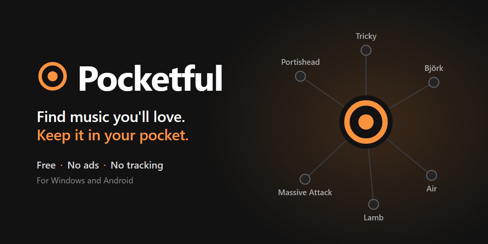

  

  <a href="https://github.com/pocketful-official/pocketful/releases/latest"><b>Download</b></a> ·
  <a href="https://pocketful-official.github.io/pocketful/">Website</a> ·
  <a href="CHANGELOG.md">What's new</a> ·
  <a href="https://pocketful-official.github.io/pocketful/privacy/">Privacy</a> ·
  <a href="https://pocketful-official.github.io/pocketful/contact/">Contact</a>

# Pocketful

**Find music you'll love. Keep it in your pocket.**

Pocketful is a free music app for Windows and Android. Walk a map of artists, start a radio
from any song, travel through hundreds of the world's genres, and keep what you love in a
library of your own, with covers and full details, on your computer, your phone and your
music players.

**No ads. No account. Nothing collected: not today, not ever.**

## Discover

- **A map of artists.** Every artist sits among their neighbours. Tap one and follow the
  threads somewhere you've never been.
- **Radios from anything.** Start from an artist or a song; it keeps going on the artists you
  chose and their neighbours, with deep cuts mixed in.
- **The world's genres.** Hundreds of styles from every region, each with its own colour, its
  artists and its classics. Or tap **Surprise me**.
- **Artists you love.** Your favourites and the artists next door, on shelves made from what
  you play.

## Your playlists come with you

Moving from another music app? Bring the playlists you've built over the years, in one go, with
their names and their order.

- **Paste a link** to a playlist from the app you use today.
- **Your whole library**: most music apps let you ask for a copy of your data; give that file to
  Pocketful and all your playlists come across at once.
- **From any app on your phone**: share a playlist, an album or a song to Pocketful.

## Your library

- **Your CDs**, kept in lossless quality with covers and track names.
- **Your files**, brought in and tidied by artist and album.
- **Automatic backups** with a password of your choice: a new phone or PC picks up where you were.

## Everywhere

- **Windows 10 and 11**: speakers, headphones and Bluetooth. Unzip and play, nothing to install.
- **Android 8 and newer**: the same app in your pocket, paired with your computer over your
  own Wi-Fi.
- **Players and drives**: USB drives, SD cards and music players.

## Get it

1. Open the [latest release](https://github.com/pocketful-official/pocketful/releases/latest).
2. **Windows:** get `Pocketful-<version>-win64.zip`, unzip it anywhere and open `Pocketful.exe`.
   If Windows says "Windows protected your PC", click **More info**, then **Run anyway** (it
   says this about apps without a paid certificate).
3. **Android:** on the phone, get `Pocketful-android-<version>.apk`, open it and allow your
   browser to install apps.

## No viruses. Nothing hidden. And you can check.

You don't have to take our word for it:

- **Signed by the project.** Every release is signed with a key that is kept offline and never
  goes online, and the apps refuse any update that isn't. Its public half is
  `b9daab648cf354a7838b8e92d575fc871c949cfa9fa5e5f2c6f9d6cb20b993b9`.
- **Every file's fingerprint, published.** The SHA-256 of every file comes with each release in
  `SHA256SUMS.txt`, signed with the same key.
- **Scan it yourself.** Upload the file to [VirusTotal](https://www.virustotal.com/gui/home/upload)
  and see what about 70 antivirus engines say.
- **Talks only to what it needs.** The music services it finds and plays music with, and this
  project's page on GitHub, for updates and notices. No ads, no trackers, no account.

More on the [website](https://pocketful-official.github.io/pocketful/#safe) and in
[Is it safe?](SECURITY.md)

## Support the artists

Every artist in Pocketful has a **Support** button: buy their music, see them live. The music
you love only exists because someone made it.

## Not for piracy

Pocketful is for music you have the right to use. Whether you may keep a copy depends on
where you live, and many music services' terms forbid downloading: it's your call and your
responsibility. Never share or sell what you download. Pocketful isn't affiliated with any
music service. Please read the [disclaimer](DISCLAIMER.md).

## The project

A personal, non-commercial project, made anonymously by **The Pocketful Project**. Free for
non-commercial use under the [PolyForm Noncommercial License 1.0.0](LICENSE.md).
Third-party software is listed in the [third-party notices](THIRD-PARTY-NOTICES.md), and how
to check a download in [Is it safe?](SECURITY.md)

Bugs, ideas, questions: **Feedback** in the app's Settings, or the
[contact page](https://pocketful-official.github.io/pocketful/contact/).
